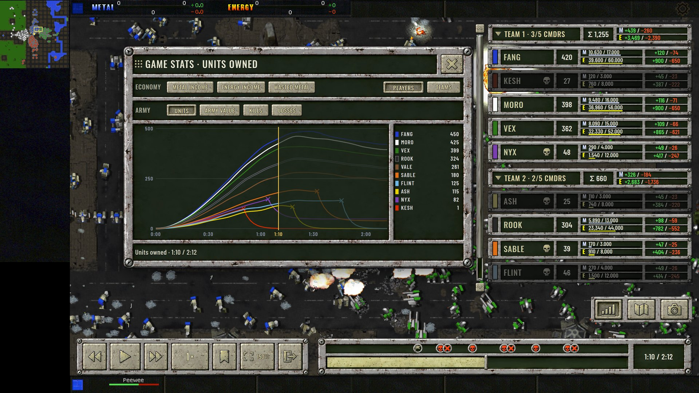
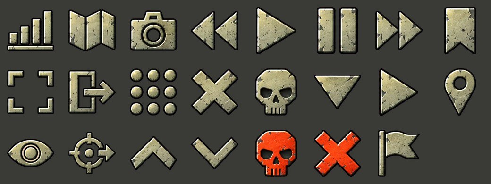
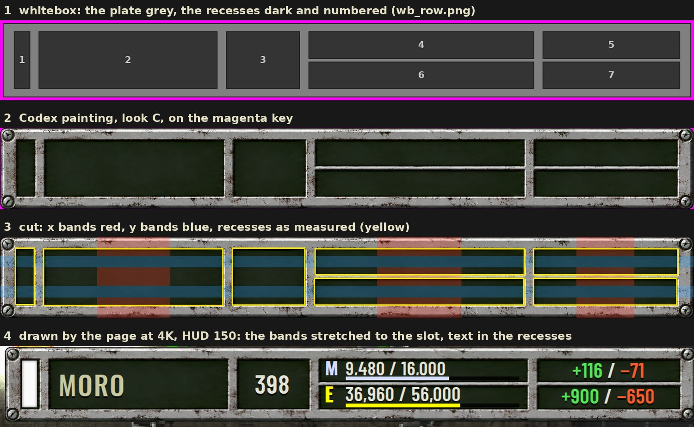
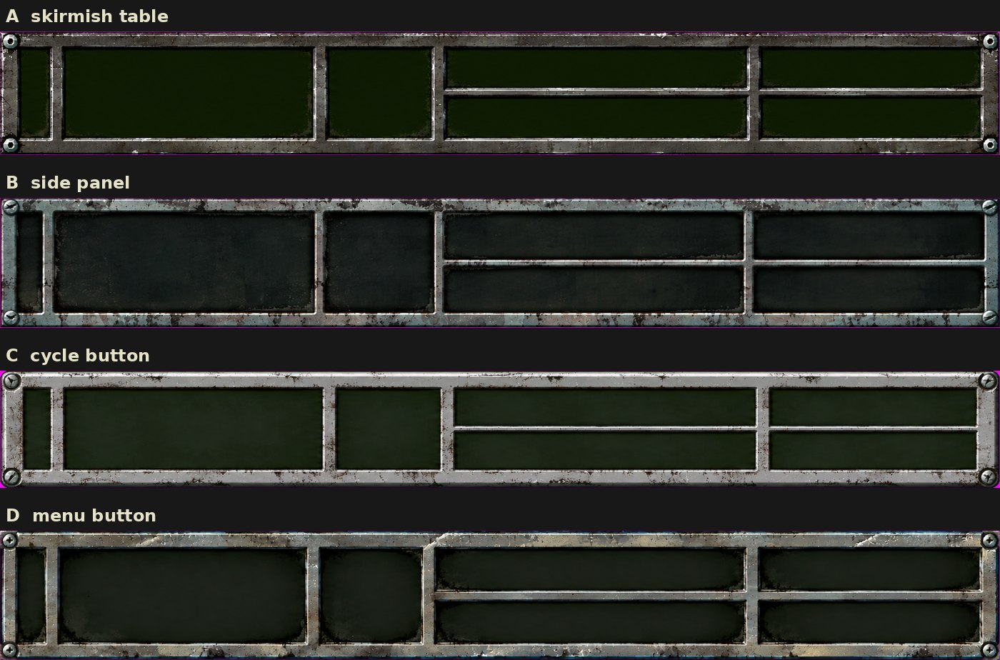
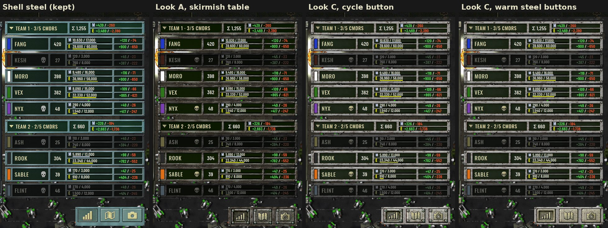
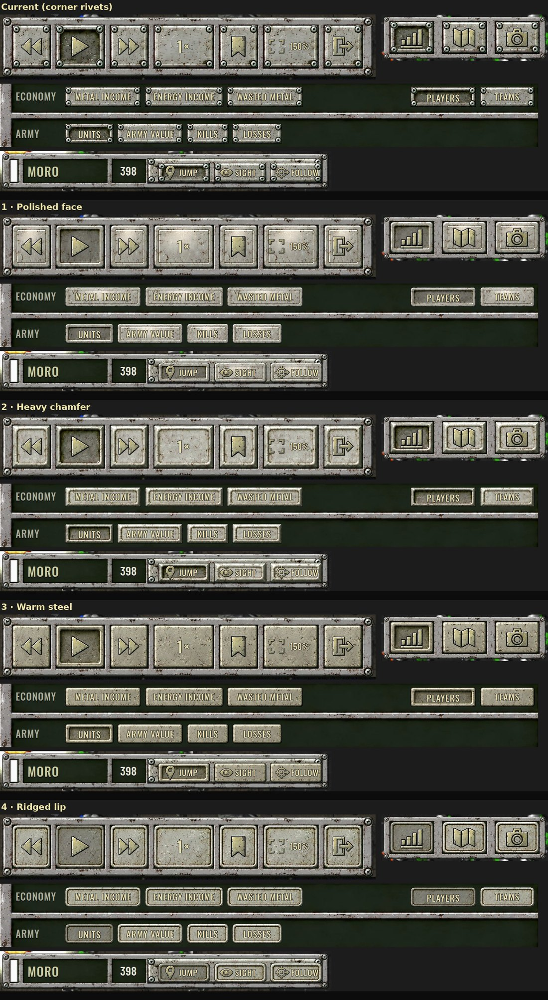
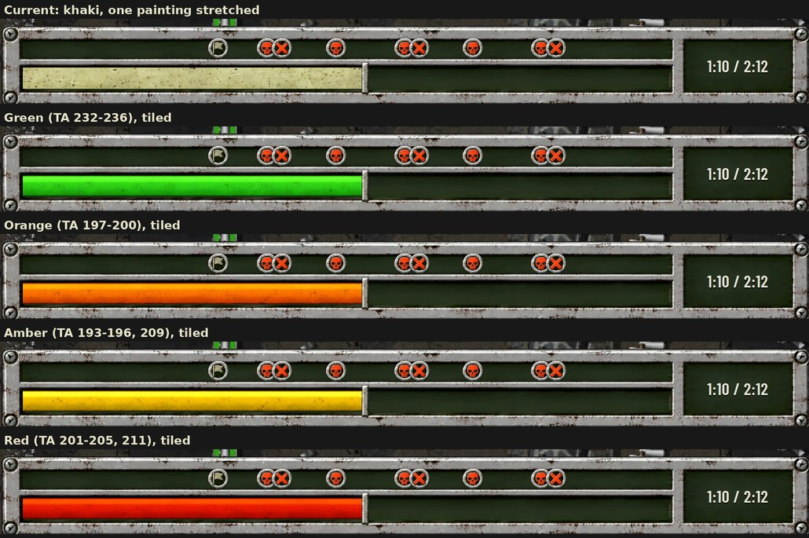
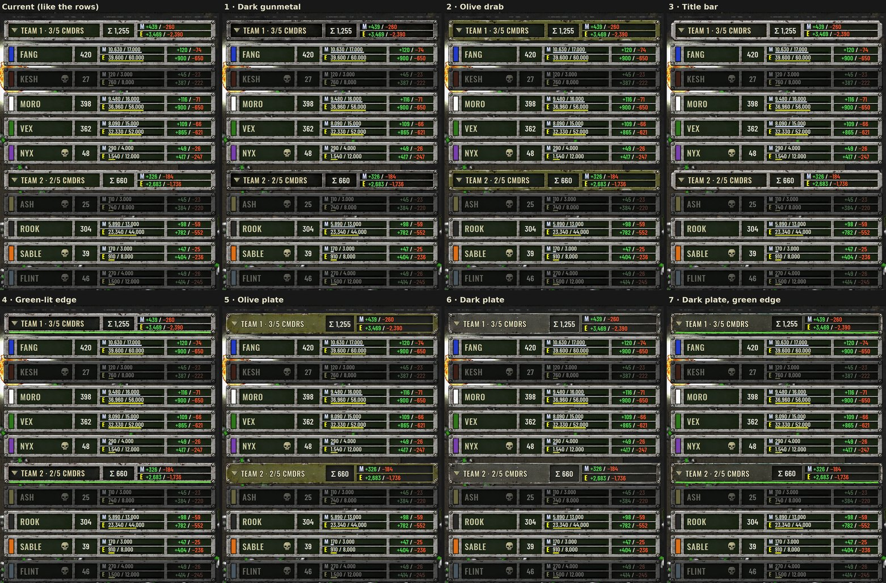
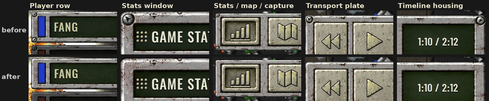

# The replay HUD's art: painted, cut and grid-sliced

## Status

**A prototype, with its look chosen on 2026-10-07.** The watching HUD of the
[demo recorder's S5](tadr-port/demo-recorder-s5-ui.md) is being redesigned as high-resolution art
that scales with the screen, in a browser prototype. The owner chose:

- **The layout:** E1.
- **The look:** C, *cycle button*, which is light distressed gunmetal.
- **The buttons:** warm steel.
- **The timeline fill:** green, from TA's green ramp, repeated along the groove rather than
    stretched.
- **The team header:** a solid dark plate with the team's title written on it.
- **No screws, rivets or bolts** on any part: every corner is plain worn steel.

Nothing of it is drawn by the DLL yet; *Gaps* at the end says what is missing.

This page is the record of how the art is made, so that a part can be repainted, re-cut or tweaked
without rediscovering the method:

- the style guide;
- the prompts;
- the tools and what each one measures;
- the drift to expect from the painter;
- the decisions that led to this look.

| What | Where |
|---|---|
| The tools: whitebox, cutters, packer, captures | `tools/hudart/` (table in *The pipeline*) |
| The part specs: sizes and recesses in HUD units | `tools/hudart/specs/` |
| The style guide, the prompts, the method, the decisions | this page |
| The paintings, the cut kits, the prototype page, every Codex output | **not in the repository** (below) |

**Not in the repository.** On the reference setup, the paintings, the cut kits and the page are
archived in the main checkout's `.data/hud-art/`, which `.gitignore` ignores:

- `work/e1/`: the paintings, by part and look, with the prompts as they were sent;
- `work/e1/kit/V1/`: the kit;
- `work/proto/`: the prototype page;
- `codex/`: every image the Codex thread generated.

The prototype page and its packed kits are also held by a private artifact. Among the archived
files are the reference crops Codex was shown of Total Annihilation's own interface. **They are
original game art and are never committed** (CLAUDE.md, *Publishing*).

**Evidence tags.**

- **MEASURED:** measured on the paintings or the page, with the numbers.
- **[INFERRED]:** not proved.

[](assets/hud-art/final.jpg)

*The chosen HUD, at 3840×2160 with HUD 150 (shown halved). Its parts:*

- *the dock along the bottom: the transport plate, then the timeline housing with its marker lane;*
- *the player column on the right, grouped under dark-plate team headers;*
- *the stats / map / capture plate under the column;*
- *the stats window, open.*

## What is painted

The layout is E1, settled in the prototype on 2026-10-06 and 2026-10-07 (*The exploration*):

- **The dock.** A transport plate (rewind, play, forward, speed, bookmark, UI scale, leave) and a
    timeline housing with a marker lane, a groove and a time readout. The housing is drawn as wide
    as the screen leaves. On a 16:9 screen that is 1152 / HUD scale − 310 units: 458 at HUD 150 and
    1226 at HUD 75. The fill inside its groove is 92 units shorter: 366 units at 4K and HUD 150,
    MEASURED as 1646 device pixels in the page.
- **The player column**, 250 units wide. Players are grouped under **team headers** that fold:
    - A header shows the team's title, its unit count, and its summed metal and energy income.
    - A **row** per player shows the colour stripe, the name, a skull when the commander is lost, the
      unit count, metal and energy stored over storage with a bar, and metal and energy income.
    - Hovering a row shows a strip with **Jump, Sight and Follow**.
    - A player cannot be selected (owner, 2026-10-07).
- **A button plate** with three bays: stats, map overlay and capture.
- **The stats window.** It has a title strip, a close bay, an economy tray and an army tray of
    choice buttons, a line chart, its legend and a caption line.

### HUD units, and how sharp the art is

Everything is laid out in **HUD units**: u = stage height / 720 × HUD scale. A unit is one pixel of
a 720-line screen at HUD 100. At 3840×2160 and HUD 150, the reference setup's play settings,
u = 4.5 device pixels.

The art stays sharp while it is painted at more pixels per unit than it is drawn at. The cut look-C
plates are MEASURED at these sizes:

| Part | Painted | px per unit | Design height, as painted |
|---|---|---|---|
| Player row | 2024 × 237 | 8.1 | 29.3 (asked: 27) |
| Team header | 2046 × 242 | 8.2 | 29.6 (asked: 23) |
| Button plate | 1833 × 477 | 14.8 | 32.3 (asked: 36) |
| Transport plate | 1945 × 312 | 6.8 | 45.6 (asked: 46) |
| Timeline housing | 2056 × 259 | 4.9 | 52.9 (asked: 46) |
| **Stats window** | 1322 × 903 | **3.1** | 292.4 (asked: 272) |
| Buttons, warm steel | e.g. bay button 234 × 196 | 7.0 – 9.3 | — |
| Timeline fill, one tile | 755 – 1002 × 77 | 6.4 | 12.0 (asked: 12) |

**The stats window is the one part below 4.5.** At 4K and HUD 150 it is magnified 1.46×, which
*Gaps* lists. The design height is the painting's, not the whitebox's. *One scale per part* below
explains why.

## The style guide

### Total Annihilation's distressed gunmetal

These rules hold for every part, in every look. They come from TA's own interface: crops of the
skirmish player table, the side-panel and cycle buttons and the in-game menu, sampled for colour by
role, with no map, unit or cursor pixels in the sample.

- **Colour.** Neutral grey steel:
    - plate greys `#434241`, `#5c5d58`, `#6d6e68`, `#7b7b7b`;
    - button face `#9fa1a0`;
    - bevel light `#c9cdcd`;
    - at most a hint of warmth, `#8d8f81`.
    - **No cyan, teal or blue tint anywhere.** The first art round's clean cyan brushed steel was
      the owner's "colour/texture is off".
- **Texture: distressed, battle-worn metal**, as TA's own plates are up close:
    - scratches and scuffs in every direction;
    - small dents and pitting;
    - grime and dark soot gathered in the corners and along the recess rims;
    - edges and bevels worn bright where they would be rubbed;
    - a mottled, uneven surface with dark speckle.
    - **Never clean, never long brushed streaks, never a smooth gradient.** Naming the wear is what
      worked: the palette alone gave clean steel.
- **Shape.** Crisp bevels, light along the top and left and dark along the bottom and right, with
    a thin near-black outline. **No screws, rivets or bolts:** a corner is plain worn steel, the
    bevel running round it unbroken.
- **Wells (recesses).**
    - Near-black, like TA's own wells (`#070f01`, `#0e0c13`).
    - Darker and calmer inside than the plate, because text goes on them.
    - Grime along their rims.
    - Always empty: **text is never painted** (*Text and indicators*).

### Look C, chosen: cycle-button steel

- The lighter button-face steel (`#9fa1a0`, bevel light `#c9cdcd`).
- The thick, rounded, bevelled frame of TA's cycle buttons.
- Plain worn corners, with no screws.
- Heavy wear: chips, pitting, dark paint flecks, grime along the recess rims.
- Dark wells.

### Look A, kept as the alternative: skirmish table

- The darker gunmetal frame of TA's skirmish player table (`#26241f` – `#434241`).
- Its bevelled corner screws.
- Near-black olive wells.

Every part exists in this look too, under `@a` (*The kit's names*).

### Buttons: warm steel, chosen

- **The face:** slightly warmer than the plates, toward `#8d8f81` / `#a8a690`, with a darker
    outline, so the button stands apart from the cool steel it sits in.
- **Pressed:** the face sooty and darker, with a soft inner shadow, pushed in.
- **On a button, never:**
    - screws, rivets or bolts;
    - dark blocks or notches in the corners;
    - lamps.

### Team header: a solid dark plate, chosen

- **A solid plate,** so that the header reads as a field of paint where every row is a light frame
  around dark recesses. Recolouring a frame does not do it (*The exploration*, step 10).
- **Dark gunmetal** like TA's skirmish player table (`#26241f` – `#434241`), with its outer bevel worn
  bright (`#9fa1a0` – `#c9cdcd`).
- **The title is written on the plate,** in a text zone (*Text zones*): light `#ece6c0` with a
  near-black outline. Only the unit sum and the two income lines sit in recesses.
- **No screws** at the corners.

### Pressed, selected, on: one state

**A button that is held, selected or on is pressed in. There is no other state language:**

- no lamps;
- no LEDs;
- no glows;
- no brightness change on a row.

Owner, 2026-10-07: "just a 'pressed in' look would probably be enough". The same holds for the
toggles (map overlay, stats window open) and for the selected choice in each tray.

### Text and indicators

- **Text is drawn, never painted:** player names, numbers, labels, the window title. The page uses
    Oswald 500, upper case:
    - in a well: TA's khaki `#c8c8a0`;
    - on a raised look-A or look-C face: `#e2dcb0` with a near-black outline on four sides, since a
      light label on light steel otherwise disappears.
- **Resource colours are TA's own bar fills:**
    - metal `#d3dbff` (palette 224);
    - energy `#ffff00` (palette 208).
    - The source is in the [engine map](exe-reverse-engineering.md), *The resource block, and the
      33-byte memo that skips it*: the side data's `metalcolor` / `energycolor`.
    - The saturated blue of TA's METAL title is the title's ramp, not the bar's. Sample an indicator
      where it lives, never a label beside it.
- **The timeline's played fill: green**, a lit strip in TA's green ramp, palette 232–236:
    - highlight `#7bff77`;
    - body `#53df4f` to `#33bf2b`;
    - shadow `#1b9f13` to `#1b7f0b`.

    It is saturated so that it reads against the near-black groove and the light steel. It is
    **repeated along the groove, never stretched** (*Tiled fills*). Orange, amber and red were
    painted too and are kept in the kit:

    - amber sits close to the energy bar's yellow;
    - red is the colour of the death and defeat markers above the groove;
    - orange sits near those markers' red-orange.

- **Icons:**
    - khaki stencil `#c8c8a0` – `#abaa83`, with a thin near-black outline so they read on dark and
      light steel alike;
    - a slight bevel, and the same wear as the plates;
    - the death skull and the defeat cross in red, `#fc3c0c`.
    - One icon set serves both looks.

[](assets/hud-art/icons.jpg)

*The 23 icons, cut from one painting.*

## The pipeline

1. **A whitebox:** a flat diagram of the part with its recesses numbered and a legend, on the
    magenta key.
2. **Codex paints it**, given the whitebox, the style prompt and the reference crops.
3. **A cutter cuts the painting:**
    - it keys the part out;
    - it measures the recesses and the slice lines off the paint, not off the whitebox;
    - it writes the part with its measurements.
4. **The parts are filed under their look and packed for the page.**
5. **The page draws each part at any size.** It stretches only bands chosen to cross plain recess
    middles, and places the text in the recesses as measured.

| Tool | What it does |
|---|---|
| `whitebox.py <spec> <out>` | Renders a one-piece part's whitebox: `<out>.png` for Codex and `<out>.json` for `gridslice.py` |
| `sheets.py <parts spec> <out dir>` | Renders the parts sheets, one grey cell per part and one dashed square per icon, plus `sheets.json`. `PLAIN=1` leaves out the corner marks |
| `gridslice.py <painting> <whitebox.json> <kit dir> <part>` | Cuts a one-piece part: the recesses as painted and the stretch bands |
| `cut.py <parts spec> <painting> <sheet> <sheets.json> <kit dir>` | Cuts a parts sheet into 9-slice parts. `PRESSED_DARK=<weight>` makes pressed slots prefer darker shapes. `one:<part>` in place of `<sheets.json>` cuts a part painted on its own: one cell, the whole painting |
| `iconcut.py <painting> <kit dir> <name>...` | Cuts icons as whole shapes, in reading order. `ICON_DIL=<px>` joins strokes that far apart |
| `tile.py <kit dir> <part>...` | Makes cut strips repeat along x without a seam, in place (the timeline fill) |
| `keying.py` | `despill`: takes the magenta back out of anti-aliased edges (all three cutters use it) |
| `lookmerge.py <cut dir> <look> <kit dir>` | Files freshly cut parts into the kit as `<part>@<look>` |
| `pack.py <kit dir> <out.json> [<page> <version>]` | One JSON of data URIs per kit; with a page, also its measurements into the page |
| `capture.sh <page url> <out.png>` | The page's HUD at device scale, after every part has been composed |
| `compare.sh <page> <query> <prefix>` and `compose.py` | The button states of one set (play held, stats on, choices selected, a row's Jump held), side by side |

The tools need Python 3 with numpy, scipy and Pillow (the shared venv,
`.venv-undither/bin/python`), plus DejaVu Sans Bold for the sheet labels. The captures need
`playwright-cli`.

### 1. The whitebox

**A one-piece part** (row, header, plate, window, transport, timeline) is a module in
`tools/hudart/specs/`:

- `DESIGN`: the part's size in HUD units.
- `S`: sheet pixels per unit.
- `CELL`: where the part sits on the sheet.
- `ZONES`: each recess as `(x, y, w, h)` in units.
- `LEGEND`: what goes in each recess, printed under the part.
- `XB` / `YB`: for each stretch band, the recesses it must run through.
- `TEXT`, optional: each **text zone**, where text is written on the plate itself rather than in a
    recess. The whitebox outlines it, and `gridslice.py` places it from the whitebox (*Text
    zones*).

```
.venv-undither/bin/python tools/hudart/whitebox.py row  wb_row       # -> wb_row.png, wb_row.json
```

| Spec | Part | Design | Recesses | Stretch bands run through |
|---|---|---|---|---|
| `row` | Player row | 250 × 27 | stripe, name, units, m_store, m_inc, e_store, e_inc | x: name; both stores; both incomes. y: the metal line; the energy line |
| `head` | Team header | 250 × 23 | title, sum, m_inc, e_inc | x: title; both incomes. y: the metal line; the energy line |
| `plate` | Stats / map / capture plate | 124 × 36 | three bays | x: each bay. y: all three |
| `window` | Stats window | 428 × 272 | title, close, tray_eco, tray_army, chart, legend, foot | x: title, both trays, chart, foot. y: chart and legend |
| `transport` | Transport plate | 284 × 46 | rew, play, fwd, speed, bookmark, uiscale, leave | x: speed; uiscale. y: every bay |
| `timeline` | Timeline housing | 420 × 46 | markers, track, time | x: markers and track. y: time with markers; time with track |
| `head_plate` | Team header as a solid plate | 250 × 23 | sum, m_inc, e_inc; the title is a text zone | x: title; both incomes. y: the metal line; the energy line |

**The separate parts** (buttons, strips, scroll parts, timeline fill, playhead, marker badge) and
the icons are cells of a **parts sheet**. They are defined in `specs/parts_look.py` (15 parts and 23
icons), `specs/parts_buttons.py` (the 9 button parts alone) and `specs/parts_fill.py` (the four
timeline fill strips). Each part is
`(name, w, h, border, label, mode)`, sizes in units. `mode` is one of:

- `''`: a 9-slice part;
- `'core'`: a fill. The page draws only its bright core, stretched over the bar, because its own
    frame would sit inside the slot's;
- `'fixed'`: drawn at its own size;
- `'tile'`: a strip that repeats along x. `cut.py` measures no insets for it, `tile.py` makes it
    repeat without a seam, and the page lays it along the whole groove (*Tiled fills*).

```
PLAIN=1 .venv-undither/bin/python tools/hudart/sheets.py parts_buttons sheets/   # parts_col.png, sheets.json
```

Render button sheets **with `PLAIN=1`**. The default sheet marks each corner a part may shape with a
dark square, and Codex reads a dark square as a place for a screw, or copies it as a dark block.

### 2. The reference

Codex is shown **crops of TA's own interface** as the style reference, captured from the game with
`tacli shot`:

- the main menu's buttons;
- the skirmish setup's player table;
- the in-game side panel (ORDERS, MOVE, STOP);
- the cycle buttons;
- the in-game menu;
- the top bar's meters;
- stencil titles;
- a palette strip sampled from interface pixels only.

The reference crops are composed into one image. **They are original game art: they stay in the
local archive and in private artifacts, and are never committed.** Tell Codex that the reference is
inspiration for the look, not a template to copy.

### 3. Codex paints

The painter is Codex, run as an **interactive session** with its image-generation tool:

- **Paths, not attachments.** Each prompt names the images by local path (the whitebox, the
    reference, and the earlier paintings in the same look).
- **Print and stop.** Each prompt ends with "print the generated image paths and stop".
- **Copy the images out yourself.** The images land under `~/.codex/generated_images/<thread>/`.
    Under the `workspace-write` sandbox, Codex cannot copy them anywhere itself.
- **One thread per round.** Keep the whole round in one thread, so "matching your card C exactly"
    refers to a painting the thread made itself.
- **Check that a paste was submitted.** When the session is driven by pasting into its terminal,
    the Enter after a paste does not always take: read the pane before assuming the prompt went in.
- **Order of work:**
    1. Ask for **one component in several looks** first (the player card, A to D).
    2. Once a look is liked, ask for the rest of the HUD in that look, **one image per one-piece
       part** plus one parts sheet.
    3. Then the icon sheet.
    4. Then any focused pass (the buttons).

The prompts are in *The prompts*.

### 4. Cut

```
PY=.venv-undither/bin/python; H=tools/hudart
$PY $H/gridslice.py painted_head.png wb_head.json cut/ head_one              # one-piece parts
PRESSED_DARK=1.5 $PY $H/cut.py parts_buttons painted_3.png col sheets/sheets.json cut3/
ICON_DIL=25 $PY $H/iconcut.py painted_icons.png icons/ i_stats i_map i_cam ...  # names in reading order
$PY $H/cut.py parts_fill painted_fill.png col sheets/sheets.json fill/           # fill strips are cut,
$PY $H/tile.py fill/ track_fill_green track_fill_orange track_fill_amber track_fill_red  # then tiled
$PY $H/cut.py parts_look painted_hover_strip.png col one:hover_strip cut/   # a sheet part painted alone
```

**What `gridslice.py` prints:**

- each recess, measured beside its whitebox value;
- each stretch band, with its **stray**: how far a cross-section inside the band differs from the
    band's median one, in 0–255 levels. A plain band strays by about 2.

Any recess that found no dark region is named. **Look at every cut**, then draw the bands and
recesses on the piece, as in the figure under *How the cutters measure*.

### 5. File and pack

```
$PY $H/lookmerge.py cut/ c kit/V1          # head_one -> head_one@c, and so on
$PY $H/pack.py kit/V1 V1.json index.html V1
```

#### The kit's names

A part is filed as `<part>@<look>`. The page resolves a name in this order, taking the first that
exists:

1. `<part>@h<n>`: the team header variant n (only `head_one` has them);
1. `<part>@c<n>`: the button set n, under look C (`@c3` is warm steel);
2. `<part>@<look>`: `@a` or `@c`;
3. `<part>@gm`: the shared icons;
4. `<part>`: the shell-steel part.

So a focused pass (one button set) only adds the parts it repaints.

The look-C, warm-steel HUD draws from:

- the six one-piece plates `@c`, except the team header, `head_one@h6`;
- the remaining look-C parts `@c`;
- the nine buttons `@c3`;
- the 23 icons `@gm`;
- the timeline fill `track_fill_green@gm`, one tile shared by every look.

The kit holds 175 parts across shell steel, A, C, the four button sets, the icons and the four
fills. It packs to 6.3 MB (MEASURED).

### 6. Check

```
tools/hudart/capture.sh 'http://127.0.0.1:<port>/index.html?paused&res=3840x2160&hud=150&view=live&e1v=V1&look=c&btn=3#E1' hud.png
tools/hudart/compare.sh http://127.0.0.1:<port>/index.html 'look=c&btn=3' cmp/w3
.venv-undither/bin/python tools/hudart/compose.py cmp.png '3 · Warm steel=cmp/w3'
```

- **Run every capture at device scale.** `capture.sh` and `compare.sh` both do.
- **Wait for the art.** They wait until every grid-sliced part has its composed image, and print
    "missing art" (it must be 0).
- **Look at native 4K.** Judge the art at native 4K, never through a downscaled capture.
    `playwright-cli`'s own screenshot is CSS-scale even at device scale factor 2, and a headless
    browser given a virtual-time budget captures before the kit has loaded.
- **Serve the page locally.** `hud` in the query is a percentage (`hud=150`).

## How the cutters measure

[](assets/hud-art/pipeline-row.jpg)

*The player row through the pipeline: the whitebox, the look-C painting, the cut with its stretch
bands and measured recesses, and the row as the page draws it.*

### Keying and despill

**The key is flat `#FF00FF`.** The key mask is the product of two terms, each clipped to 0–1:

- magenta-ness: `(min(r, b) − g − 60) / 120`;
- red-equals-blue: `1 − |r − b| / 90`.

Paint is where the mask is under 0.5. **Every pixel then takes the colour of its nearest solid
pixel**, so the edges keep no key colour.

`despill` takes the key's share back out of mixed pixels: `s = clip((min(r, b) − g − 6) / 255, 0,
0.7)`, then `(p − s·(255, 0, 255)) / (1 − s)`.

- For neutral paint, that share is exact.
- Paint with no red-and-blue excess over green is left alone: greys, khaki, and TA's reds and
    oranges.
- Without it, a dark outline anti-aliased into the key survives as an opaque purple line.
- MEASURED on look C: no pinkish pixels left, and the recess measurements unchanged.

### One-piece parts: recesses and stretch bands (`gridslice.py`)

**One scale per part.** The scale is the painting's width over the design width, on both axes. The
design height is then **taken from the painting**:

- Codex paints off-aspect, with frames thicker than asked (the table in *HUD units*).
- Scaling x and y apart would squash its round screws and bevels.
- The stretch bands absorb the difference instead.

**The recesses.**

1. **The dark mask.** Otsu's split of the part's brightness separates recess from plate.
    - **A dark plate** lands on the dark side with its recesses. The cutter catches this when
      the dark side covers more than the recesses' share of the whitebox plus 0.2, and then
      splits the dark side again, separating near-black recess from dark paint.
    - A light plate never triggers it: every earlier one-piece painting re-cut identically
      (MEASURED, 16 parts).
2. **Regions.** The dark mask is **eroded by one HUD unit**, so grime or a shadow along a rim
    cannot join two recesses into one region.
3. **One-to-one matching.** Each whitebox recess is matched to **one** region by the Hungarian
    method. The cost is the centre distance, plus the log ratio of the widths, plus the log ratio of
    the heights.
4. **Extents.** A recess's extent is then scanned outward from its region's centre on the un-eroded
    mask: across the middle band of rows, then down the middle half of columns.

A painting that keeps the layout but shifts or resizes a recess (a taller title strip pushing
everything down) still pairs correctly. MEASURED, against every earlier painting after the change:
within 0.33 units.

**Stretch bands.**

- **Where they go.** A band spans the overlap of the recesses its spec lists, trimmed by 30 % at
    each end. It therefore lies **inside the recesses, where every cross-section is plain**: the
    recess floor, its two rims and the plate between them repeat along it.
- **What they do.** Everything outside the bands keeps its painted size when the part is drawn
    larger: corners, screws, bevels and recess ends.
- **What `gridslice.py` reports.** Each band's stray (about 2 when the band is plain).

### Parts: shape matching and 9-slice insets (`cut.py`)

1. **The shapes.** They are the connected painted regions on the key, after a 2-pixel dilation.
2. **Matching.** Shapes are matched to the sheet's cells one-to-one by the Hungarian method. The
    cost is:
    - the centre distance;
    - plus 1.5 × the log aspect-ratio difference;
    - plus 0.5 × the log size difference.
3. **`PRESSED_DARK=<w>` (for button sheets).** It adds `w × z` to a pressed slot's cost and
    `−w × z` to a raised one's, where `z` is the shape's standardized mean brightness.
    - A pressed part therefore takes the darker shape of a pair.
    - A sheet with an extra or shuffled shape cannot hand a raised face to a pressed slot.
    - The warm-steel set was cut with 1.5.
4. **9-slice insets.** Each inset is measured by comparing **whole cross-sections** with a typical
    one from the middle third, scanning outward:
    - each cross-section has its mean removed first, so a slow gradient does not count;
    - the slice line goes where the sections stop matching, so a bracket or bolt is enclosed in its
       corner and never stretched with the edge.
    - A thin bar gets equal end caps.

### Icons (`iconcut.py`)

- **Whole shapes.** The N largest painted shapes, after a dilation that joins one icon's strokes,
    become the N icons.
- **Reading order.** Shapes whose vertical centres lie within half an icon's height share a row; a
    row reads left to right.
- **Why not cells.** It does not depend on the painting keeping the sheet's aspect ratio. Cutting
    from widened cells grabbed pieces of the neighbouring icon (map plus camera, 2026-10-07).
- **`ICON_DIL`.** Use about 25 for an icon made of separate strokes, like the four corner brackets
    of UI scale.

### Text zones

A part may carry text on its plate rather than in a recess: the solid-plate team header writes its
title on the paint.

- **The spec** lists the area under `TEXT`.
- **The whitebox** outlines it in light grey. The prompt calls the outline a marker that is never
  painted.
- **`gridslice.py`** puts it into the part's `wells` at its whitebox place, scaled to the painting's
  height, and lists it under `text`. Nothing is measured there: the area is plain plate, so a few
  tenths of a unit off cost nothing.
- **The page** writes text in a text zone light (`#ece6c0`) with a near-black outline, since it sits
  on paint rather than in a near-black well.

### Tiled fills (`tile.py`)

**Why tile.** The timeline's fill runs up to 1134 units long, painted as a strip
200 units long. Stretched, a painting smears its wear into streaks, and the texture slides as the
fill grows. So the strip is repeated instead, and the repeat must not show.

1. **The ends go.** Columns not fully painted are dropped, then 4 % more at each end, because Codex
    shades a strip's ends.
2. **The length.** The tile is a slice `seg[0:L]` of the strip. For each L from 55 % of the strip
    up, the strip's continuation `seg[L:L+o]` is compared with its start `seg[0:o]`, over an overlap
    o of 12 % of the strip. The L where they match best wins.
3. **The seam.** The tile's first o columns are rebuilt from those two:
    - the continuation left of the cheapest top-to-bottom path through their difference;
    - the start right of it;
    - feathered over 3 px (image quilting).

    Nothing is blended across the whole overlap, so the wear keeps its contrast.

4. **Why the wrap cannot show.** The tile's last column is `seg[L-1]` and its first is `seg[L]`,
    neighbours in the painting. The only join is the seam inside the tile, between two stretches of
    paint chosen because they look alike there.

MEASURED on the four fill strips:

- **Tile lengths:** 755 to 1002 px, or 118 to 156 units.
- **The wrap:** the colour step across it is 0.7 to 1.9 levels, against a median step between
  neighbouring columns of 1.0 to 1.5 (0–255).
- **Repeats:** a 366-unit groove (4K, HUD 150) shows a tile 2 to 3 times; the longest, 1134
  units at HUD 75, 7 to 10 times.

### How the page draws a grid-sliced part

Drawing at a target size T for a design length D, with stretch bands of total length S
(`gpMap`):

- **The fixed bands keep their size, and the stretch bands share the change:** each stretch band is
    multiplied by (T − (D − S)) / S.
- **Smaller than the fixed bands** (T < D − S), the whole part scales uniformly instead.

**One image per drawn size.** The part is composed **into one canvas** at the drawn size times the
device pixels per unit (`gpCompose`). The cells share rounded edges, so there are no seams. The
composed image is cached by size.

**Text and fills are placed through the same mapping, inside the recesses as measured:**

- the stored line's text is sized to the drawn recess;
- its bar sits a fixed distance off the recess floor.

A painting taller than its slot therefore still fits its digits.

**A part laid over the mapped recesses lays out its children from its own drawn size.** The hover
strip covers a row's resource recesses, so its size comes out of the mapping: 134.3 × 19.4 units at
a row 27 units tall. It spaces its three buttons with one 2.5-unit margin on every side and between
them. Buttons placed for a fixed 141 × 22 strip ended 0.3 units from its right and bottom edges, and
8 and 3.5 units from its left and top edges.

**A tiled fill** (`tileCompose`) is drawn into one canvas as well:

- **Scaled with its neighbours.** The tile is scaled to the drawn height inside a strip of three
  copies, so the resampling at its edges sees its periodic neighbours.
- **Copied at whole-pixel steps,** so no copy overlaps another.
- **Laid along the whole groove.** The fill element uncovers the strip up to the playhead, so the
  texture stays put while the fill grows.

### Packing (`pack.py`)

**Why one JSON:** an artifact version holds at most 511 files, so a kit is one JSON of data URIs
rather than a file per part.

**Why WebP over 60 KB:** a part over 60 KB goes as WebP at quality 92 with lossless alpha. The
distressed paintings are noise that PNG cannot compress, and an artifact file holds at most 16 MB.

| Kit as packed | Size | Rendered HUD, against the PNG kit |
|---|---|---|
| All PNG | 25 MB | — |
| Parts over 60 KB as WebP | 5.3 MB | within 1/255 on average |

## Codex's drift, and the fix for each

| What comes back | Fix |
|---|---|
| Frames and bars between recesses **thicker than asked**: the first cards were 33–35 units tall for a 27-unit slot, recesses right, frame +50 % | Give the **aspect ratio and the frame thickness in pixels of the whitebox** ("the card is 1500 × 162 px, 9.26 : 1; the frame above and below the recesses 18 px of 162"). The repaint came back at 29–32. Then build from the measured height, never the asked one |
| Recesses **shifted** (a taller title strip pushes the rest down) | One-to-one matching in `gridslice.py`. Regress against the earlier paintings after any change to it |
| **A part added or dropped** on a sheet | State the exact count ("exactly NINE parts") and list them; cut with `PRESSED_DARK` |
| **Screws on every button**, or dark blocks in the corners | `PLAIN=1` sheets, and say "no dark blocks, notches, screws or rivets in any corner" |
| **Clean cyan brushed steel** from a palette alone | Name the wear and the neutral greys, ban cyan / teal / blue, and show TA's own crops |
| **Purple fringe** around the parts | `despill`, which all three cutters run |
| **Icons at another aspect ratio**, so neighbours bleed into each other's cells | `iconcut.py` (whole shapes) instead of cell cuts |
| **A single large feature** on a part that is stretched very wide | "Spread the wear evenly along its length, no single large feature" (the timeline housing) |
| **Text or numbers painted into recesses**, or the legend painted | "Never paint the legend, numbers or text"; recesses "empty, darker and calmer than the plate" |

## The prompts

**Each prompt is built from these blocks**, with the paths filled in. They are the prompts that
produced the chosen art, with each correction that mattered folded in. The prompts as they were
sent, corrections and all, are in the local archive beside their paintings.

### The style block, in every prompt

```
Total Annihilation's interface is neutral GUNMETAL GREY and DISTRESSED. Reference, crops of TA's own
interface: <reference.png> (the skirmish player table, the side-panel buttons, the cycle buttons, the
in-game menu buttons, and the steel palette taken from the interface). It is inspiration for the
look, not a template. Match TA closely:
- Colour: neutral grey steel from that palette (#434241, #5c5d58, #6d6e68, #7b7b7b, button face
  #9fa1a0, bevel light #c9cdcd), at most a hint of warmth (#8d8f81). NO cyan, teal or blue tint
  anywhere.
- Texture: distressed, battle-worn metal, the way TA's own plates look up close: scratches and scuffs
  in every direction, small dents and pitting, grime and dark soot gathered in the corners and along
  the recess edges, edges and bevels worn bright where they would be rubbed, a mottled uneven
  surface with dark speckle. Never clean, never long brushed streaks, never a smooth gradient.
- Shape: crisp bevels, light along top and left, dark along bottom and right, a thin near-black
  outline; the recesses near-black (#070f01 / #0e0c13) like TA's wells, their insides darker and
  calmer than the plate (text goes on them), with grime along their rims.
```

### The look

```
LOOK C, CYCLE BUTTON: the lighter button-face steel (#9fa1a0, bevel light #c9cdcd) inside the thick
rounded bevelled frame of TA's cycle buttons, its corners plain worn steel with NO screws, rivets or
bolts; heavy wear (chips, pitting, dark paint flecks, grime along the recess rims); dark wells. Match
your painting <an earlier look-C painting> exactly.
```

```
LOOK A, SKIRMISH TABLE: the darker gunmetal frame of TA's skirmish player table (#26241f-#434241)
with its bevelled corner screws; near-black olive wells.
```

The card round asked for four looks in one prompt, each one image following the row whitebox:

- **A. Skirmish table:** as above.
- **B. Side panel:** "the mid-grey bevelled plate of TA's in-game side-panel buttons (ORDERS, MOVE,
    STOP), #5c5d58-#7b7b7b".
- **C. Cycle button:** as above.
- **D. Menu button:** "TA's in-game menu button: a grey face inside a double frame (an outer dark
    line, then a light inner bevel), the most worn and grimy of the four".

### A one-piece part

```
<style block> <look block>
Paint ONE image following the whitebox <wb_head.png> exactly: the same image size and aspect ratio
(the part there is <1500 x 138> px, <10.87> : 1); the recesses in the same places at the same sizes;
the frame and the bars between recesses as thin as the whitebox's grey (the frame above and below
the recesses <n> px of <H>; measure against the whitebox, frames have come back 50% too thick).
No screws, rivets or bolts anywhere; the corners plain worn steel. Recesses empty, darker and calmer
than the plate. Never paint the legend, numbers or text. Pure flat #FF00FF outside the part.
<window:   A slightly heavier outer frame, since it is a window.>
<timeline: It is stretched very wide in the game: spread the wear evenly along its length, no single
           large feature.>
Print the generated image path and stop.
```

The whitebox sizes of the parts, in pixels, as sent:

| Part | Size | Ratio |
|---|---|---|
| Player row | 1500 × 162 | 9.26 : 1 |
| Team header | 1500 × 138 | 10.87 : 1 |
| Button plate | 1240 × 360 | 3.44 : 1 |
| Stats window | 1541 × 979 | 1.57 : 1 |
| Transport plate | 1562 × 253 | 6.17 : 1 |
| Timeline housing | 1596 × 175 | 9.12 : 1 |

### The parts sheet of a look

```
<style block> <look block>
Paint the parts sheet <parts_col.png>: every grey cell becomes its part, at the cell's place and
size, empty of text and icons: the bay button face (raised, like a TA cycle button in this look) and
the same button PRESSED IN (sunk, darker face, inner shadow along its top and left); the choice
button and pressed; the close button and pressed; the action strip shown over a row (a thin plate)
with its action button and pressed; the scroll track, thumb and arrow button; the played part of the
timeline as a lit bar in TA's khaki (#c8c8a0 to #abaa83), worn; the playhead as a small steel
needle; the round marker badge like a screw head with a dark centre (small red icons sit on it).
No screws, rivets or bolts on any other part. Exactly <15> parts. Plain edges between the dashed lines; #FF00FF outside the cells.
Print the generated image path and stop.
```

### The buttons: warm steel

```
<style block> Keep look C's style: the same light chipped steel, colour family, wear and bevel (the
plates they sit in: <painted_tp.png>, <painted_foot.png>, <painted_win.png>).
NO screws, rivets or bolts anywhere on a button; no dark blocks or notches in any corner. No lamps
or lights: pressed reads from shape and shade alone.
Paint the sheet <parts_col.png> (rendered with PLAIN=1). The image must hold exactly NINE parts,
each grey cell at its place and size: bay button, bay PRESSED, action button, action PRESSED, choice
button, choice PRESSED, close, close PRESSED, scroll arrow. Empty of text and icons; pure flat
#FF00FF everywhere else.
WARM STEEL: a slightly warmer face (toward #8d8f81 / #a8a690) with a darker outline, so it stands
apart from the cool plate. Pressed: the face sooty and darker with a soft inner shadow, pushed in.
Print the generated image path and stop.
```

The other three sets were asked for in the same prompt:

- **1. Polished face:** "the face worn smooth and brighter in the middle, a crisp light bevel.
    Pressed: the bevel inverts (dark top and left, light bottom and right), the face a shade
    darker".
- **2. Heavy chamfer:** "a thick rolled chamfer like TA's cycle buttons around a flat face. Pressed:
    sunk, dark gap all round, deep shadow inside the top and left edges, the face darker".
- **4. Ridged lip:** "a raised lip round the face, its top worn bright, the corners simply rounded.
    Pressed: the lip flattened and dark, the face flat and dimmer".

### The icon sheet

```
ONE icon set shared by both looks (it sits on dark and light buttons). Paint the icon sheet
<parts_icons.png>: each of the 23 dashed squares gets its icon, centred in it, filling about 80% of
it, in reading order:
stats = a bar chart; map = a folded map; camera = a camera; rewind = two triangles pointing left;
play = a triangle pointing right; pause = two bars; forward = two triangles pointing right;
bookmark = a bookmark ribbon; UI scale = four corner brackets forming a square; leave = a door with
an arrow pointing out; grip = a 3 by 3 grid of studs; close X = an X; skull = a skull; team open =
a solid triangle pointing down; team shut = a solid triangle pointing right; jump = a map pin;
sight = an eye; follow = a crosshair with a small arrow; up = a chevron pointing up; down = a
chevron pointing down; RED skull = a skull in red #fc3c0c; RED X = an X in red #fc3c0c; flag = a
small pennant flag.
Style: Total Annihilation's stencil lettering (see the labels in <reference.png>): khaki #c8c8a0 to
#abaa83 (the two red ones red), a thin near-black outline so they read on dark and light steel
alike, a slight bevel, and the same wear as the plates: chipped edges, scuffs, grime. Bare symbols,
no button or plate behind them. Keep each icon's pieces close together and leave wide gaps between
icons. Pure flat #FF00FF everywhere else; never paint the labels. Print the generated image path and
stop.
```

### The timeline fill

```
The timeline's PLAYED FILL only, the bar that fills the timeline groove from the start up to the
playhead (today: <dock capture>; the housing it sits in: <painted_rail.png>). It must be DISTINCT, in a
clear colour, and it must TILE along its length: a slice of it is repeated end to end to cover a
groove up to 1200 units long, so it is never stretched.
Paint the sheet <parts_col.png> (specs/parts_fill.py): each of the four grey cells becomes one long
fill strip, at its place and size, in its own colour from Total Annihilation's own palette:
1. GREEN: TA's green ramp, highlight #7bff77, body #53df4f to #33bf2b, shadow #1b9f13 to #1b7f0b.
2. ORANGE: highlight #efa71b, body #eb8f13 to #e77b0f, shadow #df4f07.
3. AMBER: highlight #fbf383 to #f3d34f, body #efbb33 / #ffbf00, shadow #9b832f.
4. RED: highlight #ff4700, body #d72300 to #bf1f00, shadow #931700 to #7b1300.
Each strip is a LIT indicator bar, saturated and bright, so it reads at a glance against the
near-black groove and the light steel around it: a bright highlight band along its upper third,
deepening toward the bottom, a thin darker edge along the top and the bottom. Give it the HUD's
distressed wear at a FINE scale: light scratches, specks of grime, slight mottling, spread EVENLY
along the whole length. NO end caps, NO rivets or screws, NO single large scratch, chip, dent or
blotch, and no change of shade along the length: any slice of the strip must look like any other,
because slices are repeated end to end. Both ends plain and straight (they are cut away). Exactly
FOUR strips. Never paint the labels. Pure flat #FF00FF everywhere else.
Print the generated image path and stop.
```

Codex returned all four strips on the first try, even along their length.

### The team header

The first round kept the header's layout:

```
Next: the TEAM HEADER only. Today (<column capture>; its painting: <painted_head.png>) it is painted
exactly like the player rows under it, the same light steel, frame and recesses, so it blends into
the list. The owner wants it EASY TO SEE as the start of a team: a section header, not one more row.
Paint FOUR variations. Each is one image following the whitebox <wb_head.png> exactly: <the size,
aspect and frame thicknesses in pixels, as in "A one-piece part">. Keep the HUD's distressed wear and
no cyan, teal or blue.
1. DARK GUNMETAL: the plate in the dark gunmetal of TA's skirmish player table (#26241f to #434241),
its bevels and edges worn bright (#9fa1a0 to #c9cdcd) ...
2. OLIVE DRAB: the plate painted in chipped military olive-drab enamel from TA's palette (highlight
#93936f, body #636343 to #535333, shadow #434323 to #333317), the paint worn through to bare light
steel along the edges and around the screws ...
3. TITLE BAR: the same light steel as the rows, but a different silhouette: the four corners cut at
45 degrees instead of screws, a thicker rolled outer frame with a deeper shadow under it ...
4. GREEN-LIT EDGE: the same light steel plate as the rows, with a thin LIT strip in the timeline's
green running the whole width inside its bottom frame, under the recesses, like a glowing underline.
```

The second round made it a solid plate, on the `head_plate` whitebox:

```
Next round: the header as a SOLID PLATE, so it reads as a field of paint where a row is a frame
around dark recesses. Paint THREE images, each following the whitebox <wb_headplate.png> exactly:
<size and aspect>; only THREE recesses (1 unit sum, 2 metal income, 3 energy income); area 4 is
where the game WRITES the team title directly on the plate: paint it as plain plate, NO recess, NO
border, NO panel (its light outline in the whitebox is only a marker, never paint it). <frame
thicknesses in pixels>.
5. OLIVE PLATE: the whole plate chipped military olive-drab enamel from TA's palette (<the olive
ramp>), a broad even field across area 4 so light text reads on it, the paint worn through to bare
light steel along the outer edges and around the four corner screws.
6. DARK PLATE: the whole plate dark gunmetal like TA's skirmish player table (#26241f to #434241), a
broad even field across area 4, its outer bevel worn bright (#9fa1a0 to #c9cdcd), round slotted
screws at the four outer corners.
7. DARK PLATE WITH GREEN EDGE: exactly 6, plus a thin LIT strip in the timeline's green running the
whole width inside the bottom frame, under the recesses, like a glowing underline.
```

The pick was repainted with one change:

```
Repaint your image <painted_6.png> exactly as it is (the same image size, the same dark gunmetal
plate and wear, the same worn-bright outer bevel, the same three recesses at the same places and
sizes, the same plain area where the title is written) with ONE change: remove the four round
slotted screws at the corners. Each corner becomes plain worn dark plate, the bright outer bevel
running round it unbroken. No screws, rivets, bolts or holes anywhere. Pure flat #FF00FF outside
the header. Print the generated image path and stop.
```

It came back changed only at the corners. Its recesses measure within 0.15 units of the version
with screws (MEASURED), so a focused repaint from Codex's own painting is a safe way to remove one
feature.

**Where the headers came back.** The first round came back 29.4 to 30.0 units tall for 23,
like today's header. The second came back 21.9 to 24.6 units tall. Codex painted area 4 as plain
plate, without copying its marker outline.

### Removing a feature from finished parts

Each part is repainted from its own painting, one image per source, so nothing but the feature
changes. This took the screws off every plate (*The exploration*, step 11):

```
Repaint each of these <7> images on its own, one generated image per source, in this order. Keep each
exactly as it is: the same image size and aspect ratio, the same light chipped look-C steel, the same
wear, bevels and outline, every recess at the same place and size, the same plain #FF00FF outside the
part. Make ONE change: remove every round slotted screw. Each corner where a screw was becomes plain
worn steel, the bright bevel running round it unbroken. No screws, rivets, bolts or holes anywhere.
Never add text.
1. <painted2_c.png> (the player row: screws at its four corners)
...
7. <src_scroll_track.png> (the scroll track: two screws at its top end and two at its bottom end; the
ends become plain rounded steel)
Print the <7> generated image paths, 1 to <7>, and stop.
```

- **A part cut from a parts sheet has no painting of its own.** Send its cut piece, padded with
    the key by an eighth of its longer side all round, and cut the repaint with `cut.py
    one:<part>`.
- **How they came back** (MEASURED, 2026-10-07):
    - The five one-piece plates kept their size. Their recesses moved by 0.07 to 0.33 units, and
      their heights by 0.4 units at most.
    - The two sheet parts came back 3.5 and 6 times larger, as whole images. The cutter takes the
      scale from the painting, so the size only makes them sharper. Their insets came out the same
      in units, except a soot stain that widened one fixed edge of the hover strip.

### The proportions repaint

Send this when a painting came back with frames too thick:

```
The look is right; keep it exactly as it is (colour, wear, bevels). But it came out too TALL
for the slot: your part is about <1950 x 265> px (<7.4> : 1), the whitebox part is <1500 x 162> px
(<9.26> : 1). The recesses are the right height; the outer frame and the bars between recesses are
about <50%> too thick. Repaint it from your own image <painted.png> at the whitebox's proportions:
the frame above and below the recesses <18> px of <162>; the bar between the upper and lower
recesses <6> px of <162>; the frame left of the first recess and the bars between recesses as thin
as in the whitebox. Pure flat #FF00FF outside the part. Print the path and stop.
```

## Recipes

- **Re-cut without repainting:** to change a band, the keying or the matching.
    1. Run the cutter again on the archived painting.
    2. `lookmerge.py`, then `pack.py`.
    3. Capture.

    Nothing about the art changes, so this is the cheapest tweak. A one-piece kit entry holds the
    whole painted part, so even without the archive the packed kit can be re-cut.

- **Repaint one part in the chosen look:**
    1. Render its whitebox.
    2. Send *the style block*, *look C* and *a one-piece part*, pointing at an existing look-C
       painting for consistency.
    3. Cut it with `gridslice.py`, then compare the measured recesses with the whitebox's.
    4. If the frame came back thick, send *the proportions repaint*.
- **Change a part's layout** (a recess wider, one more recess):
    1. Edit its spec, including `XB` / `YB` if the bands' recesses change.
    2. Render the whitebox.
    3. Ask Codex to repaint from **its own painting** and the new whitebox.
    4. Cut it, then update the page's builder for that part.
- **Remove a feature from every part** (screws, a lamp):
    1. Copy the kit directory, so the old versions stay.
    2. Send *removing a feature from finished parts* with each part's own painting.
    3. Cut each with the cutter that made it: `gridslice.py` with the part's whitebox, or
       `cut.py one:<part>`.
    4. Compare the measured recesses and insets with the old kit entries.
    5. File them into the same look with `lookmerge.py`, so they replace the old ones.
- **A new pressed look, or another button set:**
    1. Render `parts_buttons` with `PLAIN=1`.
    2. Send *the buttons* with the new direction.
    3. Cut with `PRESSED_DARK=1.5`.
    4. File it as `@c<n>` with `lookmerge.py`.
- **A new look for the whole HUD:**
    1. Paint the player card first, in several directions, and let the owner pick.
    2. Paint the six one-piece parts and the parts sheet in the picked look, in the same Codex thread.
    3. Paint the icons only if the shared set does not suit the look.
- **A colour shift only** (warmer, darker): untested. Shifting a painting in post keeps its
    geometry and measurements, but the wear's highlights and soot move with it. Repainting is the
    tested path.

**After any change:** check at native 4K with `capture.sh` ("missing art 0"), and look at every cut
part before packing.

## The exploration

The decisions, in order. Each round was shown to the owner in the prototype, in a private
artifact.

1. **2026-10-06: four directions for the HUD:**
    - A, a riveted console;
    - B, telemetry;
    - C, a low profile;
    - D, broadcast.

    The owner asked for **E**: C's dock (transport plate and thin rail) and C's player column,
    drawn with A's plates. The column must hold 10 players, and more later.

2. **E1, team headers that fold**, chosen over coloured spines (E2) and a versus bar (E3). Added
    with it:
    - a **UI-scale button** on the transport plate;
    - a **game-stats window** with one line chart (economy and army measures, by player or team).
3. **The first art round:** three versions, each from a theme kit of TA crops:
    - V1, shell steel;
    - V2, field console;
    - V3, remaster.

    Shell steel was carried on. Two lessons from it, now part of the method:

    - **A kit's parts list comes from the mockup**, not the whitebox. A generic button stretched
       everywhere looked much worse than the mockup.
    - **A compound element is painted as one piece and grid-sliced.** A row built from stacked
       9-slices "is still disparate". The row, the header, the button plate, the stats window, the
       transport plate and the timeline housing each became one painting.

4. **No open player card.** Every row carries everything, and the actions moved to a hover strip
    (picked over a drawer, a foot plate and a flyout).
    - **Selected and on mean pressed in;** the green lamps went (2026-10-07).
5. **The layout was loved and the look was not:** "Total Annihilation icons are more
    gunmetal/gray", then "It does not look like distressed metal" (2026-10-07).
    - The shell-steel version was kept as a copy.
    - One component, the player card, was repainted in four TA looks (*The look*).
6. **"I love the distressed look":** looks **A and C**, carried through the whole HUD with one
    shared icon set. A player cannot be selected any more.
7. **The owner preferred C**, but disliked the corner rivets on the buttons and wanted the buttons
    to stand out more. Four rivet-free button sets were painted, each with its own pressed look.
8. **"Ok warm steel it is"** (2026-10-07): **look C with the warm-steel buttons** is the chosen
    HUD.
9. **The timeline fill** (2026-10-07). The owner asked for a fill colour that is more distinct
    than the khaki, and for a fill that repeats instead of stretching. Four colours from TA's
    palette were painted as long strips and made to tile. **The owner picked green.**
10. **The team header** (2026-10-07). It was "hard to see" and "blends in too much" with the
    player rows. Two rounds were painted:
    - **1 to 4 keep the row's layout** and change the plate: dark gunmetal, olive drab, a title
      bar with cut corners, a green-lit edge. They help only a little, because a header, like a
      row, is mostly near-black recesses inside a thin frame.
    - **5 to 7 are solid plates:** olive, dark, and dark with the green edge. The title is
      written on the paint (`head_plate`), so the header is a field of colour where every row
      is a frame around dark recesses.

    **The owner picked 6, the dark plate,** without its corner screws ("It's not needed"). It
    was repainted from its own painting with that one change.

    The lesson holds for any part that has to stand out from its neighbours: change the part's
    pattern of light and dark, not only the colour of its frame.

11. **No screws anywhere** (2026-10-07). After the header, the owner asked for every box of the
    chosen HUD to lose its corner screws, each part re-rendered on its own. Seven parts were
    repainted from their own paintings:
    - the player row;
    - the stats window;
    - the stats / map / capture plate;
    - the transport plate;
    - the timeline housing;
    - the hover strip;
    - the scroll track.

    The buttons were already rivet-free, and the marker badge, playhead, thumb and fill have
    none. The versions with screws are no longer in the kit; the archive keeps them.

[](assets/hud-art/cards.jpg)

*Step 5: the player card in the four looks, after the proportions repaint.*

[](assets/hud-art/looks.jpg)

*Steps 3 to 8: the player column and button plate at 4K, HUD 150. From left:*

- *shell steel, kept;*
- *look A;*
- *look C with its first, riveted buttons;*
- *look C with warm steel, the chosen one.*

[](assets/hud-art/buttons.jpg)

*Step 7: look C's buttons at native 4K: the riveted originals, then sets 1 to 4. Shown in each: play
held, stats on, UNITS and PLAYERS selected, and a row's JUMP held. Set 3, warm steel, was picked.*

[](assets/hud-art/fill.jpg)

*Step 9: the timeline at 4K, HUD 150. First the khaki fill, one painting stretched over the played
part; then the four tiled colours. Green was picked.*

[](assets/hud-art/headers.jpg)

*Step 10: the player column at 4K, HUD 150, with the current header, then variants 1 to 4
(top row, from the left) and 5 to 7 (bottom row). 6 was picked and then repainted without its
corner screws; the chosen HUD at the top of the page shows it.*

[](assets/hud-art/noscrews.jpg)

*Step 11: a corner of five plates at native 4K, HUD 150, before (top) and after. The scroll
track's ends sit under its arrow buttons, so its screws never showed.*

## Gaps

- **The DLL does not draw any of this.** The watching dock that landed is an engine GUI screen in
    engine pixels, magnified by HUD scale, and its art goes through `tools/artbake.py`.
    - `artbake` refuses any colour outside TA's palette and any partial alpha.
    - The distressed paintings are full colour, with soft edges.
    - Putting them in the game needs a decision and a device-resolution, alpha-blended draw pass for
      the HUD. That changes S5's art pipeline ([S5](tadr-port/demo-recorder-s5-ui.md), *The art*).
- **The stats window is painted below the resolution it is drawn at:** 3.1 px per unit against
    4.5 at 4K and HUD 150, so it is magnified 1.46×. A repaint at a larger size, or as more than one
    painting, would close it.
- **The paintings exist only in the local archive and the artifact's packed kit.** A painting
    cannot be reproduced: Codex never paints the same image twice. The prompts here reproduce the
    style, not the pixels.
- **The text is the page's web font (Oswald).** S5 has text drawn by the engine, in each style's
    font. The HUD's text in the game is undecided.
- **The stats chart shows synthetic data.** A real chart needs a per-second statistics track in the
    recording.
- **Look A, the other three button sets, the other three fills, the other six headers and shell
    steel are kept but not maintained.** A part added to look C from now on is not painted in them.
